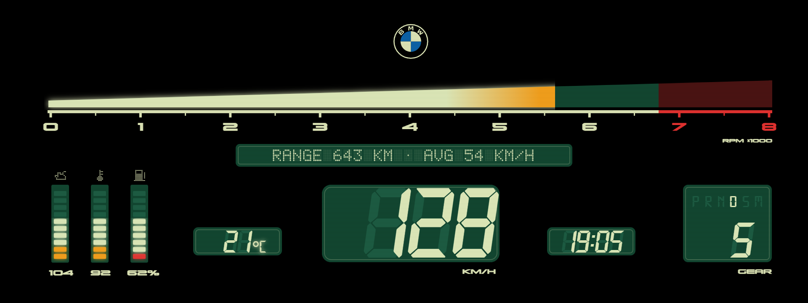
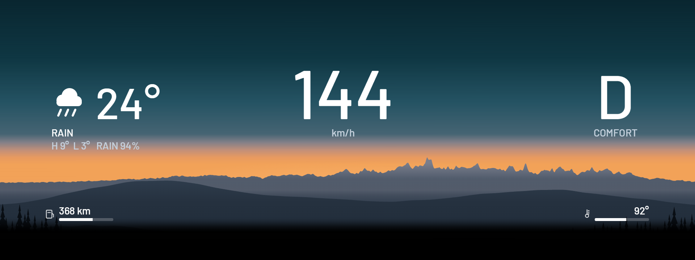

<h1 align="center">Zeiger</h1>

Hand-drawn instrument cluster themes for BMW iDrive 7 head units (MGU), installed through the community MGU Store.

## Themes

**Vintage Green** and **Vintage Amber**: an LCD from 1985, one layout in two colourings. Green: cream on dark green. Amber: amber readouts and scale, green lit segments and labels, dark amber windows.

- **Rpm:** one continuous wedge from 0 to 8000 that grows taller as it fills, cream into orange (Amber: green into amber) from 5200 and red from the scale's red line (about 6750).
- **Speed, gear, clock, outside temperature:** slanted seven-segment digits over ghost 8s, the unlit segments of an LCD.
- **Selector:** P R N D S M with the one in use lit, the gear number under it while driving.
- **Oil, water, fuel:** 10-segment bars under pixel icons, their values below (oil 40-150 °C, water 40-130 °C, fuel 0-100 %).
- **Message line** in dot matrix: the range and the average speed this drive.
- **Self-test:** at power-on everything lights for 2.5 s (888, every letter, BMW · SYSTEM CHECK), as an 80s dash did.

**Sunrise**: a sunrise over mountains with the speed in the middle, the selector and drive mode (COMFORT, SPORT, SPORT+, ECO PRO) on the right, and **today's weather** on the left: an icon, the outside temperature from the car, the day's weather and its high / low / chance of rain. The forecast comes from Open-Meteo for roughly where the car is (the internet connection's place, about 10 km), so it needs the Store's **Internet uplink** online (a phone's hotspot, USB tethering or an LTE stick); without it the theme says NO INTERNET and keeps the day's last forecast. The setting **Today's weather** turns the fetching off.

**Map**: the phone's map (Waze, Apple Maps or Google Maps over CarPlay, Google Maps over Android Auto, through waze-on-cluster) in a window in the middle of a black cluster, with only the speed, the selector and drive mode, range with a fuel bar and the coolant temperature round it, in Barlow. The window ends just left of the black box BMW draws behind its gear display, so the box falls on black and can't be seen. waze-on-cluster draws the map at its own size (leave `map_rect` empty in its conf); a map stretched over the whole cluster (`map_rect = 0,0,1920,720`) isn't supported any more.

More themes will follow. Each one starts as a drawing (Illustrator, SVG) that is turned into a theme.

**Calibration grid** and **Map calibration** (in the Theme list, with "Change with SPORT / COMFORT / ECO PRO" off) show what part of the cluster the driver sees on your car.

## Install

1. Install **cluster-render** first: Zeiger draws through it. It comes from the `robertnisipeanu/idrive-apps` Store source.
2. In the Store, go to **Settings, Add source**, enter **`vucko-adv/apps`**, pick **Branch main**, and install **Zeiger**.
3. Open Zeiger on the center screen and pick a theme. Set the units to metric: km/h and °C are drawn into the theme.

If bimmer-lab's Cluster Themes is installed, remove it first, so the two apps don't take turns on the cluster.

Installing apps that don't come from BMW on your head unit is done at your own risk and may affect your warranty.

## Black boxes on the cluster

**Black boxes in the middle with the engine running (none with it off), on a car that is not a real M:** the cluster is coded to BMW's M layout. Cars with the M Sport or M Performance package often have it coded in with BimmerCode, and with that layout BMW draws black boxes in the middle over Zeiger's themes (and over other custom cluster apps). The fix is to code the cluster back to the car's own layout (M Sport or M Performance) and restart the head unit. Checked on a G20 with the M package (November 2026): the boxes in the middle went away. Owners of real M cars report the same boxes ([bimmer-lab/apps#11](https://github.com/bimmer-lab/apps/issues/11)).

**One black box just left of the gear letter:** BMW draws it behind its own gear display on every car, over any theme, and it can't be turned off (on a G20 about x 1420-1610, y 320-435 of the 1920x720 cluster). It can't be seen on Vintage Green, Vintage Amber and Map, whose background there is black; it shows on Sunrise.

## Credits

Zeiger is a fork of [bimmer-lab/apps](https://github.com/bimmer-lab/apps) (Cluster Themes), MIT. It uses cauliflowermossgrape's MGU App Kit and Robert Nisipeanu's cluster-render. Details in [apps/zeiger/NOTICE](apps/zeiger/NOTICE).

## Developing

See [docs/DEVELOPING.md](docs/DEVELOPING.md). The bench runs on Windows too: `node bench/server-win.js zeiger`, then open http://localhost:8078.
