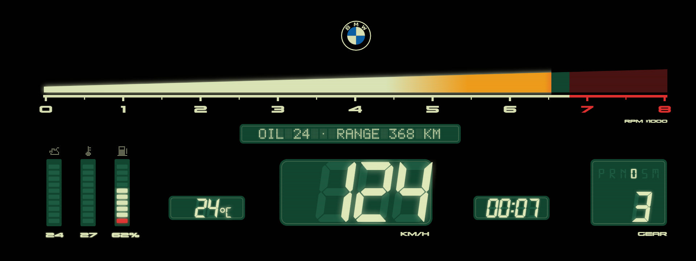
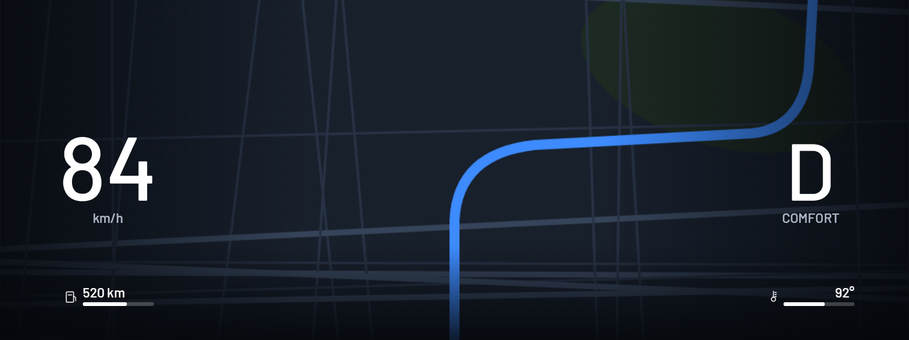
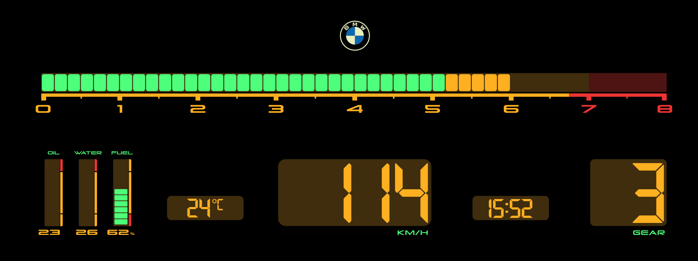

<h1 align="center">Zeiger</h1>

Hand-drawn instrument cluster themes for BMW iDrive 7 head units (MGU), installed through the community MGU Store.

## Themes

**Vintage 2**: an LCD from 1985, cream on dark green.

- **Rpm:** one continuous wedge from 0 to 8000 that grows taller as it fills, cream into orange from 5200 and red from the scale's red line (about 6750).
- **Speed, gear, clock, outside temperature:** slanted seven-segment digits over ghost 8s, the unlit segments of an LCD.
- **Selector:** P R N D S M with the one in use lit, the gear number under it while driving.
- **Oil, water, fuel:** 10-segment bars under pixel icons, their values below (oil 40-150 °C, water 40-130 °C, fuel 0-100 %).
- **Message line** in dot matrix: oil temperature and range.
- **Self-test:** at power-on everything lights for 2.5 s (888, every letter, BMW · SYSTEM CHECK), as an 80s dash did.

**Map**: the phone's map over the whole cluster (Waze, Apple Maps or Google Maps over CarPlay, Google Maps over Android Auto, through waze-on-cluster), with only the speed, the selector and drive mode, range with a fuel bar and the coolant temperature over it, in Barlow. For the map to fill the screen, waze-on-cluster needs `map_rect = 0,0,1920,720` in its `waze-on-cluster.conf`; with "Map size" set to Centre the map stays in its 1088x480 window.

**Vintage 1**: an 80s LCD dash in amber and green: amber readouts and scale, green lit segments and labels, dark amber windows, a 48-segment rpm bar amber from 5200.

More themes will follow. Each one starts as a drawing (Illustrator, SVG) that is turned into a theme.

**Calibration grid** and **Map calibration** (in the Theme list, with "Change with SPORT / COMFORT / ECO PRO" off) show what part of the cluster the driver sees on your car.

## Install

1. Install **cluster-render** first: Zeiger draws through it. It comes from the `robertnisipeanu/idrive-apps` Store source.
2. In the Store, go to **Settings, Add source**, enter **`vucko-adv/apps`**, pick **Branch main**, and install **Zeiger**.
3. Open Zeiger on the center screen and pick a theme. Set the units to metric: km/h and °C are drawn into the theme.

If bimmer-lab's Cluster Themes is installed, remove it first, so the two apps don't take turns on the cluster.

Installing apps that don't come from BMW on your head unit is done at your own risk and may affect your warranty.

## Credits

Zeiger is a fork of [bimmer-lab/apps](https://github.com/bimmer-lab/apps) (Cluster Themes), MIT. It uses cauliflowermossgrape's MGU App Kit and Robert Nisipeanu's cluster-render. Details in [apps/zeiger/NOTICE](apps/zeiger/NOTICE).

## Developing

See [docs/DEVELOPING.md](docs/DEVELOPING.md). The bench runs on Windows too: `node bench/server-win.js zeiger`, then open http://localhost:8078.
