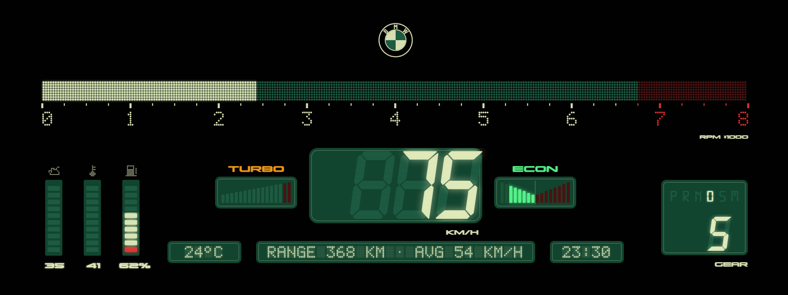
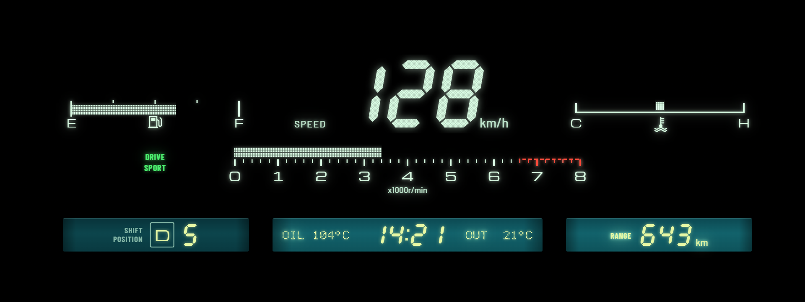
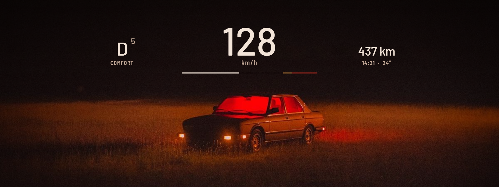
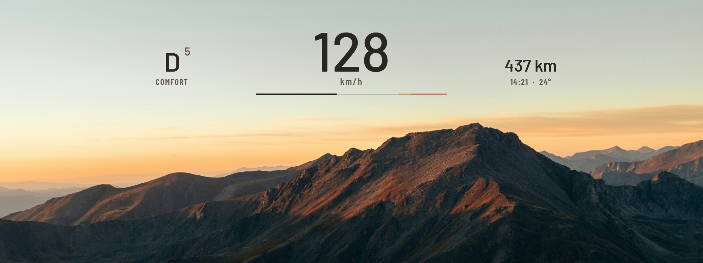
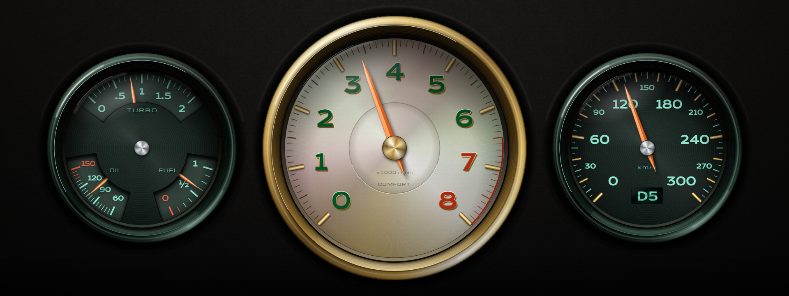

<h1 align="center">Zeiger</h1>

Hand-drawn instrument cluster themes for BMW iDrive 7 head units (MGU), installed through the community MGU Store.

## Themes

**Vintage**: an LCD from 1985, with a dot-matrix rpm band, TURBO and ECON bars beside the speed, and oil, water and fuel bars. Two colours, a Customise pick: cream on dark green, or cyan on dark teal.

**VFD**: a late-80s fluorescent display, mint phosphor on black with teal windows along the bottom.

**Apex**: a racing cluster with a rev band, boost and braking bars. The band fills on a spring with a bright head at its front and flashes toward the shift point. Two styles, a Customise pick: Clean (white) or Sport (yellow, a red glow), or Auto, Sport in the car's SPORT mode and Clean otherwise.

**Dark Moon**: a sunrise seen from orbit, with today's weather on the left.

**Underpass** and **Mist**: Dark Moon's readouts and weather over a photo.

**Ember**: an old BMW at night in a field, its cabin glowing red; the speed with a hairline rev line that turns amber and red, the gear and drive mode, range, clock and outside temperature, in a warm white above the car. Since 0.50.0 the speed limit the car's camera reads sits beside the speed in a small black and white sign. Three photos, a Customise pick: Ember's car, Sunrise's hills or Peaks' sunlit ridges (by day and by night).

**Concours**: three classic round gauges set in a leather dash. In the middle a pearl rev counter in a deep gold bezel with raised green numbers; on the left boost, oil and fuel seen through windows in the face; on the right the speedometer to 300 km/h with gold marks and the gear in a small digital screen. By day polished metal; at night the light comes from behind the bezels and falls in over the dials. BMW's M badge pressed into the middle dial; the needles move on a spring, as a real gauge's. Customise: a dark green middle dial, the speedometer's small numbers, and day, night or by the sun.

## Install

1. Install **cluster-render** first: Zeiger draws through it. It comes from the `robertnisipeanu/idrive-apps` Store source.
2. In the Store, go to **Settings, Add source**, enter **`vucko-adv/apps`**, pick **Branch main**, and install **Zeiger**.
3. Open Zeiger on the center screen and pick a theme. Set the units to metric: km/h and °C are drawn into the theme.

The weather needs the Store's **Internet uplink** online. Remove any other cluster app first, so the two don't take turns on the cluster.

Installing apps that don't come from BMW on your head unit is done at your own risk and may affect your warranty.

Settings, the start animation, the home-screen widget and black boxes on the cluster: [apps/zeiger/README.md](apps/zeiger/README.md).

## Author

Zeiger and every theme in it are drawn by **vucko-adv**. 
Instagram: [@vucko.adv](https://instagram.com/vucko.adv)
 

## Credits

Zeiger uses cauliflowermossgrape's MGU App Kit and Robert Nisipeanu's cluster-render. Third-party code, fonts and licences: [apps/zeiger/NOTICE](apps/zeiger/NOTICE) and [LICENSE](LICENSE).
