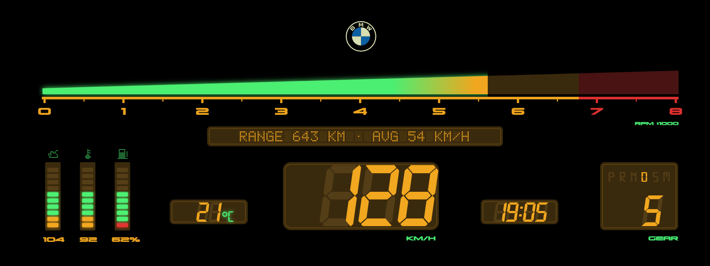
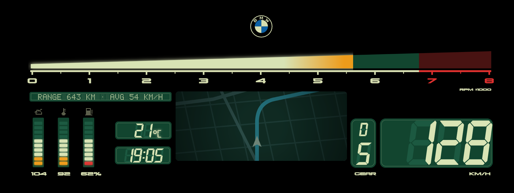
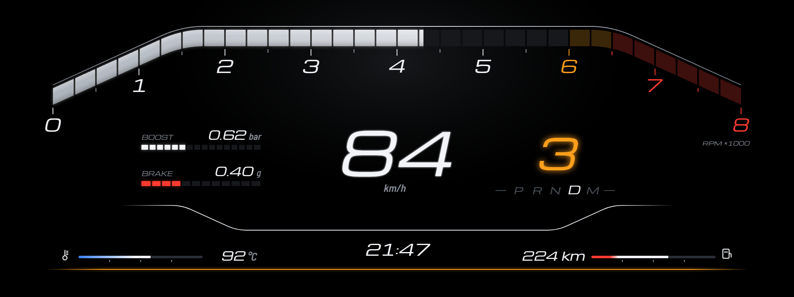
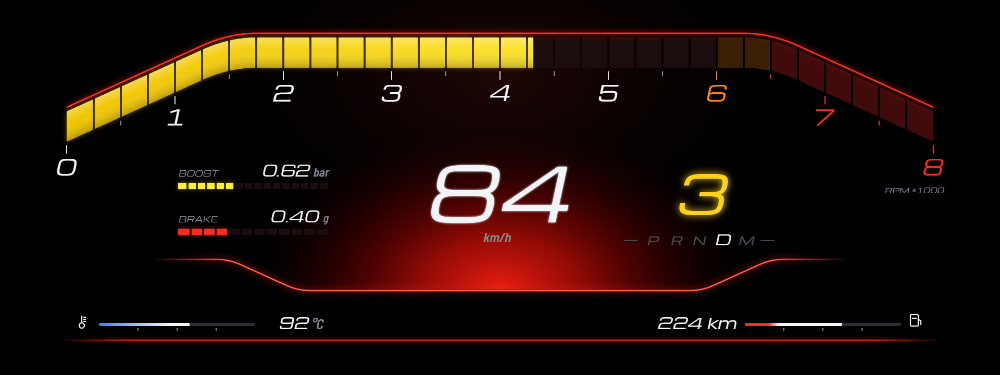
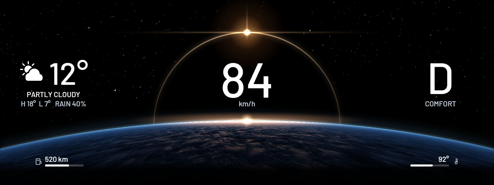
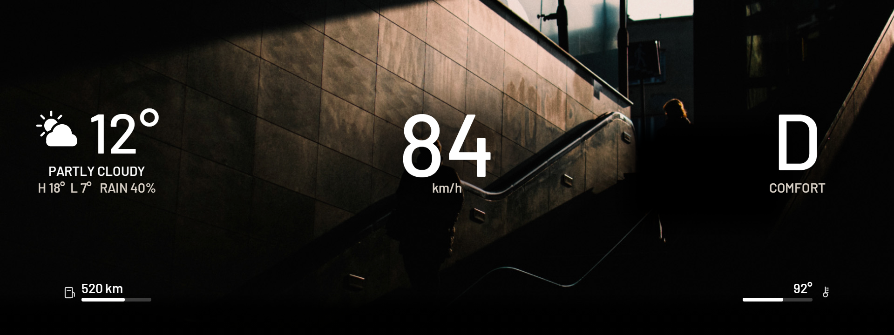
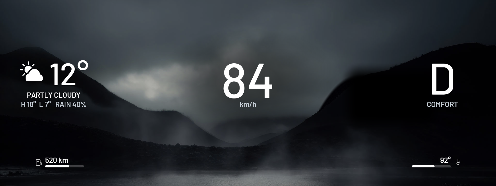
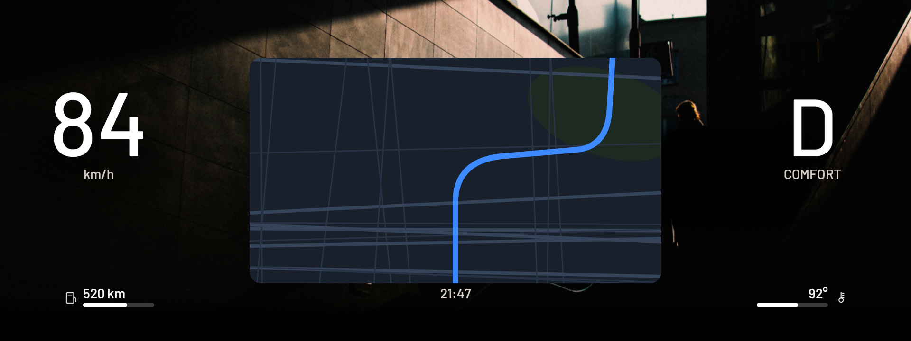
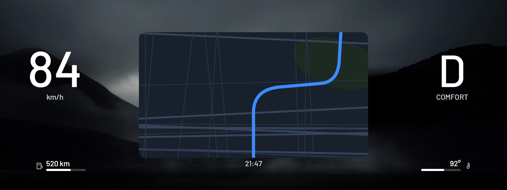

<h1 align="center">Zeiger</h1>

Hand-drawn instrument cluster themes for BMW iDrive 7 head units (MGU), installed through the community MGU Store.

## Themes

**Vintage Green** and **Vintage Amber**: an LCD from 1985, one layout in two colourings. Green: cream on dark green. Amber: amber readouts and scale, green lit segments and labels, dark amber windows.

- **Rpm:** one continuous wedge from 0 to 8000 that grows taller as it fills, cream into orange (Amber: green into amber) from 5200 and red from the scale's red line (about 6750).
- **Speed, gear, clock, outside temperature:** slanted seven-segment digits over ghost 8s, the unlit segments of an LCD.
- **Selector:** P R N D S M with the one in use lit, the gear number under it while driving.
- **Oil, water, fuel:** 10-segment bars under pixel icons, their values below (oil 40-150 °C, water 40-130 °C, fuel 0-100 %).
- **Message line** in dot matrix: the range and the average speed this drive.
- **Self-test:** at power-on everything lights for 2.5 s (888, every letter, BMW · SYSTEM CHECK), as an 80s dash did.

**With the phone's map:** while the phone's map is on (CarPlay or Android Auto through waze-on-cluster), Vintage Green and Vintage Amber change by themselves to a layout with the map. The map sits in a window under a veil in the theme's colours, with scanlines like an old screen. The temperature and clock move to its left and the speed to its right, with a tall window between them: the selector's letter over the gear number. When the map has been off for a few seconds, the plain layout comes back. The setting **Show the phone's map** turns this off.

**Apex** and **Apex Sport**: a racing cluster, one layout in two looks.

- **Rpm:** a band of 32 blocks across the top. It rises from 0 to 1500, runs level to 6500 and falls to 8000. It fills in one continuous line as the revs rise, through the blocks: white, orange from 6000, red from 6500.
- **Speed** in the middle. The **gear** is to its right (P, R, N or the number), with P R N D M under it and the one in use lit (S in the sport programme).
- **Boost and braking:** two bars left of the speed. Boost reads 0-1.6 bar. Braking reads 0-1.2 g, how hard the car is slowing, from its own acceleration sensor.
- **Coolant** and **fuel / range** bars along the bottom, and the **clock** between them.
- **Apex Sport** is made for SPORT: a red glow rises behind the middle from a red line, the band is thicker and lit yellow, and the gear is yellow. To have them change with the drive mode, turn on **Change with SPORT / COMFORT / ECO PRO** and pick Apex for Comfort and Apex Sport for Sport.
- **Shift flash (Apex Sport):** toward the shift point the whole band flashes. It flashes white from 500 rpm before the shift point, yellow from 250 before, and red at it. The shift point is **Redline (shift light)** less **Shift point before redline**, lower while the engine is cold. A redline of 6000 with 0 before it flashes at 5500, 5750 and 6000. The setting **Shift flash** turns it off.

Both work in either units (km/h or mph, °C or °F, bar or psi).

**Dark Moon**: a sunrise seen from orbit. Black space and stars, the sun coming up behind a dark moon over the Earth's thin blue limb, the speed in the moon's disc right under the sun. The selector and drive mode (COMFORT, SPORT, SPORT+, ECO PRO) are on the right and **today's weather** on the left: an icon, the outside temperature from the car, the day's weather and its high / low / chance of rain. The range and coolant are at the bottom, with a small grey clock between them. Everything mirrors about the middle. The forecast comes from Open-Meteo for roughly where the car is (the internet connection's place, about 10 km), so it needs the Store's **Internet uplink** online (a phone's hotspot, USB tethering or an LTE stick); without it the theme says NO INTERNET and keeps the day's last forecast. The setting **Today's weather** turns the fetching off.

**Underpass** and **Mist**: Dark Moon's readouts, weather and clock over a photo. Underpass: low sun on a tiled wall over a stairway, two people going up in silhouette. Mist: a misty valley between two dark hills, light breaking through the cloud.

**Map**: Dark Moon's look round the phone's map (Waze, Apple Maps or Google Maps over CarPlay, Google Maps over Android Auto, through waze-on-cluster). The map is in a window in the middle with the sun rising on its top edge; the speed is on the left, the selector and drive mode on the right, range and coolant at the bottom, with a small grey clock under the map between them. **Map Underpass** and **Map Mist** put the same window and readouts on Underpass's and Mist's photos.

More themes will follow. Each one starts as a drawing (Illustrator, SVG) that is turned into a theme.

**Calibration grid** and **Map calibration** (in the Theme list, with "Change with SPORT / COMFORT / ECO PRO" off) show what part of the cluster the driver sees on your car.

## Install

1. Install **cluster-render** first: Zeiger draws through it. It comes from the `robertnisipeanu/idrive-apps` Store source.
2. In the Store, go to **Settings, Add source**, enter **`vucko-adv/apps`**, pick **Branch main**, and install **Zeiger**.
3. Open Zeiger on the center screen and pick a theme. Set the units to metric: km/h and °C are drawn into the theme.

If bimmer-lab's Cluster Themes is installed, remove it first, so the two apps don't take turns on the cluster.

Installing apps that don't come from BMW on your head unit is done at your own risk and may affect your warranty.

## Black boxes on the cluster

**Black boxes in the middle with the engine running (none with it off), on a car that is not a real M:** the cluster is coded to BMW's M layout. Cars with the M Sport or M Performance package often have it coded in with BimmerCode, and with that layout BMW draws black boxes in the middle over Zeiger's themes (and over other custom cluster apps). The fix is to code the cluster back to the car's own layout (M Sport or M Performance) and restart the head unit. Checked on a G20 with the M package (November 2026): the boxes in the middle went away. Owners of real M cars report the same boxes ([bimmer-lab/apps#11](https://github.com/bimmer-lab/apps/issues/11)).

**One black box just left of the gear letter:** BMW draws it behind its own gear display on every car, over any theme, and it can't be turned off (on a G20 about x 1420-1610, y 320-435 of the 1920x720 cluster). It can't be seen on any of Zeiger's themes, whose background there is black.

## Credits

Zeiger is a fork of [bimmer-lab/apps](https://github.com/bimmer-lab/apps) (Cluster Themes), MIT. It uses cauliflowermossgrape's MGU App Kit and Robert Nisipeanu's cluster-render. Details in [apps/zeiger/NOTICE](apps/zeiger/NOTICE).

## Developing

See [docs/DEVELOPING.md](docs/DEVELOPING.md). The bench runs on Windows too: `node bench/server-win.js zeiger`, then open http://localhost:8078.
