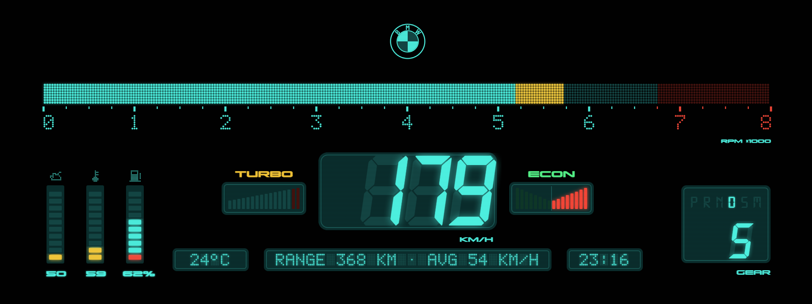
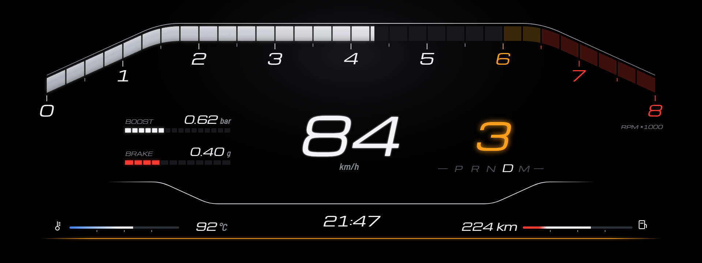
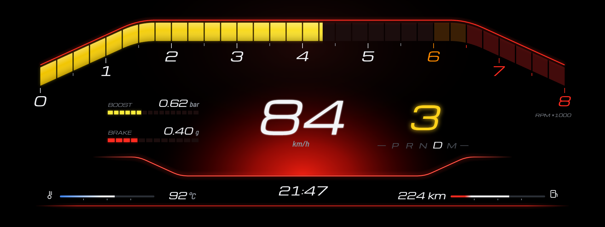
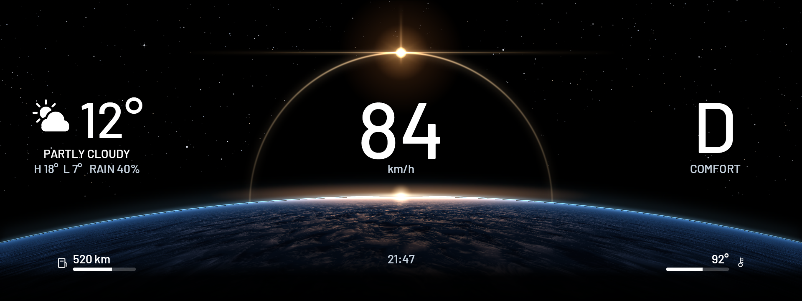
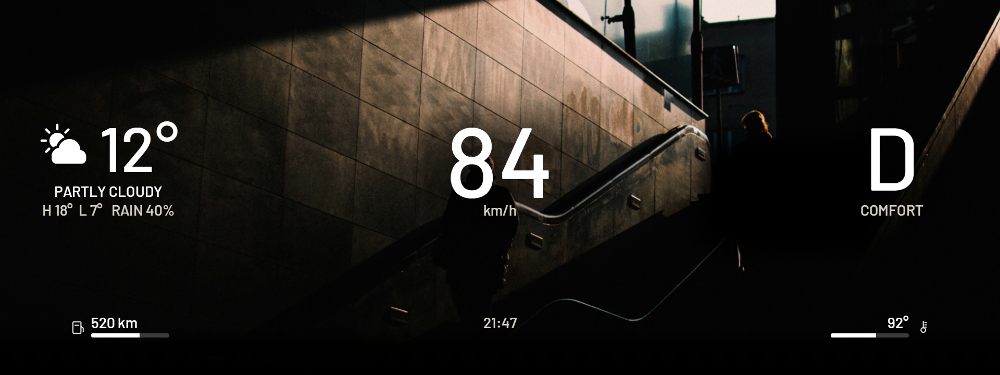
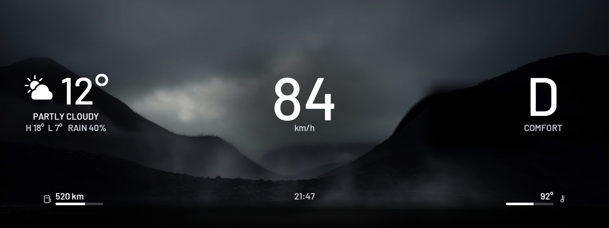
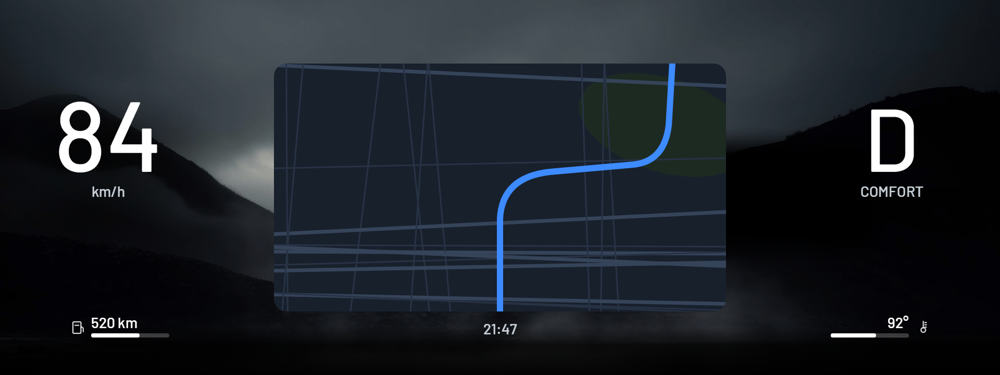

<h1 align="center">Zeiger</h1>

Hand-drawn instrument cluster themes for BMW iDrive 7 head units (MGU), installed through the community MGU Store.

## Themes

**Vintage Green** and **Vintage Cyan**: an LCD from 1985, with a dot-matrix rpm band, TURBO and ECON bars beside the speed, and oil, water and fuel bars.

**VFD**: a late-80s fluorescent display, mint phosphor on black with teal windows along the bottom.

**Apex** and **Apex Sport**: a racing cluster with a rev band, boost and braking bars. In Apex Sport the band flashes toward the shift point.

**Dark Moon**: a sunrise seen from orbit, with today's weather on the left.

**Underpass** and **Mist**: Dark Moon's readouts and weather over a photo.

**Peaks**: a minimal theme on a photo of a peak at dusk: the speed with a hairline rev line, the gear and drive mode, range, clock and outside temperature, in a warm dark ink on the light sky.

**Map Mist**: the phone's map (through waze-on-cluster) in the middle of Mist's photo.

## Install

1. Install **cluster-render** first: Zeiger draws through it. It comes from the `robertnisipeanu/idrive-apps` Store source.
2. In the Store, go to **Settings, Add source**, enter **`vucko-adv/apps`**, pick **Branch main**, and install **Zeiger**.
3. Open Zeiger on the center screen and pick a theme. Set the units to metric: km/h and °C are drawn into the theme.

The weather needs the Store's **Internet uplink** online. Remove any other cluster app first, so the two don't take turns on the cluster.

Installing apps that don't come from BMW on your head unit is done at your own risk and may affect your warranty.

Settings, the start animation, the home-screen widget and black boxes on the cluster: [apps/zeiger/README.md](apps/zeiger/README.md).

## Author

Zeiger and every theme in it are drawn by **vucko-adv**. 
Instagram: [@vucko.adv](https://instagram.com/vucko.adv)
 

## Credits

Zeiger is a fork of [bimmer-lab/apps](https://github.com/bimmer-lab/apps) (Cluster Themes), MIT. It uses cauliflowermossgrape's MGU App Kit and Robert Nisipeanu's cluster-render. Details in [apps/zeiger/NOTICE](apps/zeiger/NOTICE).
