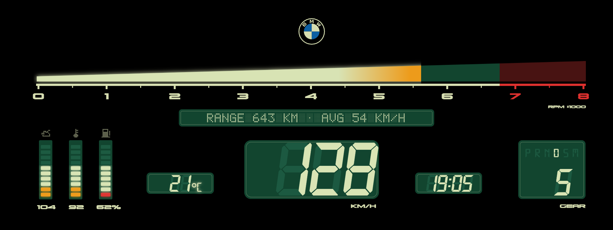

# Zeiger

Redraws the whole instrument cluster with a hand-drawn theme. Open **Zeiger** from the apps menu on the center screen: its page shows the themes, the warnings and the settings.

## Vintage Green and Vintage Amber

An LCD from 1985, drawn in code by `cluster-design/vintage2/build.html` (`?v=green`, `?v=amber`): a continuous rpm wedge (lit, orange or amber from 5200, red from about 6750), slanted digits over ghost 8s, P R N D S M, oil / water / fuel bars under pixel icons, a dot-matrix line with the range and the average speed, scanlines, and a 2.5 s self-test at power-on. Green is cream on dark green; Amber has amber readouts, green lit segments and labels and dark amber windows.

While the phone's map is on, both change by themselves to a layout with the map (`?m=1` in the same build page): the map in a window under a veil in the theme's colours, the temperature and clock to its left, the speed to its right, and between them a tall window with the selector's letter over the gear number. A few seconds after the map goes, the plain layout comes back. The setting **Show the phone's map** turns this off. The switch keeps the face pieces both layouts share on the cluster and sends only the rest, so it stays quick while the map's video uses most of the link to the cluster. Vintage takes 6.5 MiB of cluster-render's 16 MiB (its map version 7.3), next to the map's 3.2.

## Apex and Apex Sport

A racing cluster, drawn in code by `cluster-design/apex/build.html` (`?v=sport` for Apex Sport) from the same drawing as its design pictures (`draw.js`).

- **Rpm:** a band of 32 blocks (up to 1500, level to 6500, down to 8000) that fills in one continuous line through the blocks: 4 px strips of a `segments` widget, lit white (Sport: yellow), orange from 6000, red from 6500.
- **Middle:** the speed, the gear (`{{gearnum}}`) and P R N D M. The letter in use is bigger and white (`{{is:stage:X}}`); the others are dim (`{{isnt:stage:X}}`), and the fourth place shows D, or S in the sport programme.
- **Bars:** boost (0-1.6 bar) and braking (`brakeG`, 0-1.2 g), one segment at a time.
- **Bottom row:** coolant (40-130 °C) and fuel in 2 px strips, and the clock (`{{time}}`, white, Michroma 38 px) between them, where the design had a logo.
- **Apex Sport:** a red glow over a red tray line, the band thicker.
- **Shift flash (Apex Sport):** a `bandflash` effect layer (shaders.js) draws the whole band in one colour and flashes it 5 times a second. It is white from 500 rpm before the shift point, yellow from 250 before, and red at it. Only a colour and an on / off go to the car, never pixels. The setting **Shift flash** turns it off.

The glows are one quarter-size picture stretched by the GPU. The rest of the face is 6-7 pieces. Every sheet is chosen by its z group, so the theme takes about 8-9 MiB of pixel memory and 15-16 layers on two connections.

## Dark Moon

A sunrise seen from orbit, drawn in code by `cluster-design/darkmoon/build.html`: the speed in a dark moon's disc under the sun, the selector and drive mode on the right, today's weather on the left (Open-Meteo, through the Store's Internet uplink), range and coolant at the bottom with a small clock between them (`{{time}}` in the second line's grey), everything mirrored about the middle.

## Underpass and Mist

Dark Moon's readouts and weather over a photo (`cluster-design/underpass` and `cluster-design/mist`, built by `cluster-design/photo/photo_theme.js`): soft scrims behind the readouts so they read on it, and black wherever BMW's gear box lands.

## Sunrise

The first Sunrise theme (0.7-0.8, a sunrise over mountains; Dark Moon took its place in 0.9.0) back as its own theme, `sunrise_hills` (a choice saved as `sunrise` still opens Dark Moon). `cluster-design/sunrise/strip_sunrise.js` rebuilds it from the 0.8.2 files in the repo's history.

- **Above BMW's own bottom strip** (layout `"ownStrip": true`): nothing below y 646 but a black band to 662, only to 658 over the strip's drive mode and gear (x 1196-1424). The band covers the edges of BMW's dials and the line BMW draws above its strip, and stays put with **Theme position** (`"fixed"`).
- **Why:** with its strip showing, BMW is reported to leave out its black boxes (the one left of its gear display, and on cars coded to the M layout the two in the middle). The measures are Cluster Layouts' (eroobeeroo/idrive7-cluster-info), found on cars by thatgrayg22. Not yet tried on a G20 with Zeiger.
- **Duplicates:** BMW's strip also shows the gear, drive mode, range and outside temperature, which Sunrise shows too.
- The land fades to black over its last 44 px, and the range and coolant groups sit 36 px higher than before.
- **Leave BMW's bottom strip clear** doesn't squeeze Sunrise (it's already above the strip); for the other themes the setting works as before.

## Map

Dark Moon's look round the phone's map (waze-on-cluster): the map in a window in the middle with the sun on its top edge, the speed on the left, the selector and drive mode on the right, range and coolant at the bottom with a small grey clock under the map between them. **Map Underpass** and **Map Mist**: the same window and readouts on Underpass's and Mist's photos (`cluster-design/map_underpass`, `cluster-design/map_mist`).

## Home-screen widget

`widget.js`, through app.json `startWidget` and the kit's `ctx.widget` (kit/runtime/mgu.js). It uses BMW's Drive Recorder widget layout, as the kit's Live Data does (checked on a G05). The setting **Home-screen widget** picks what it shows:

- **Weather, Mist** (the default) and **Weather, Sunrise:** the weather on Mist's photo, or on the first Sunrise theme's sunrise over mountains (the one before Dark Moon). On the left: the place, the temperature now with its icon, the weather now in a word, and today's high, low and chance of rain (in blue). On the right: the next three days, each with its icon, high (white) and low (grey). It uses the cluster themes' own fonts and colours. Every line on the left shares a baseline with the right, and nothing goes below Sunrise's horizon. While the forecast shown is an old one and there's no internet, OFFLINE shows in amber beside the place. Backgrounds: `cluster-design/mist/widget_bg.html` and `cluster-design/sunrise/widget_bg.html`.
- **The cluster's theme:** ZEIGER, the shown theme's gallery picture (hud/previews, shrunk by averaging), its name, and the drive mode while "Change with SPORT / COMFORT / ECO PRO" is on.
- **Weather fetching:** the forecast (`shared/weather.js`, Open-Meteo, 4 days) is fetched while a widget is placed and shows the weather. This is apart from the themes' weather and the **Today's weather** setting. Like the themes, it needs the Store's Internet uplink.
- **Small widget:** the layout's text lines only (ASCII: the place, the weather now, today's high / low / rain, the next days).
- **Refresh:** redrawn when what it shows changes, else the same picture again every 30 s, in case the HMI dropped it.

## Fail-safe

Every layer of the theme plays a cluster-render animation: it holds its scale for 1.2 s and then shrinks to nothing. The engine (shared/hud.js `_failsafe`) starts it over every 200 ms, with the same animation number, so the service replaces it. If Zeiger hangs, the renewals stop and cluster-render takes the theme away on its own clock, so BMW's own cluster shows.

While the car moves, if the speed signal is over a second old, the theme hides at once and comes back half a second after the speed returns. Only the speed is checked, because a hybrid's rpm stays at 0, unchanged, while it drives on electricity. The log notes the longest gap between renewals once a minute when it is over 400 ms.

The bench shows both (bench/README.md): the hang button (`POST /hang`) and `stall: ["speed"]` in manual signals.

## Settings

- **Change with SPORT / COMFORT / ECO PRO:** a theme per drive mode, or one theme always.
- **Theme position:** px to the right (negative: left), -12 by default.
- **Today's weather** (Dark Moon, Underpass, Mist, Sunrise): on by default.
- **Home-screen widget:** Weather, Mist (default), Weather, Sunrise, or The cluster's theme.
- **Units:** metric (km/h and °C are part of the drawing). **Clock:** 12 or 24 hours. **Time zone.** **Tank size.**
- **Warnings:** oil and water values flash red over their limits.
- **Calibration grid** and **Map calibration** help measure what BMW hides on your car's cluster.

## Black boxes

- **In the middle, with the engine running, on a car that is not a real M:** the cluster is coded to BMW's M layout (often done with BimmerCode on cars with the M Sport or M Performance package). Code it back to the car's own layout (M Sport or M Performance) and restart the head unit; the boxes go away (checked on a G20, November 2026).
- **Just left of the gear letter:** BMW draws it behind its gear display on every car, over any theme. It can't be seen on any of Zeiger's themes (black background there).

## How a theme is made

1. Draw the cluster at 1920x720 (Illustrator, export SVG).
2. A build page turns the drawing into a face picture, segment bars and fonts (`cluster-design/<theme>/build.html` next to this repo).
3. The layout (`hud/layouts/<name>.json`) places the live parts. Widget types are documented in `shared/hud.js`.
