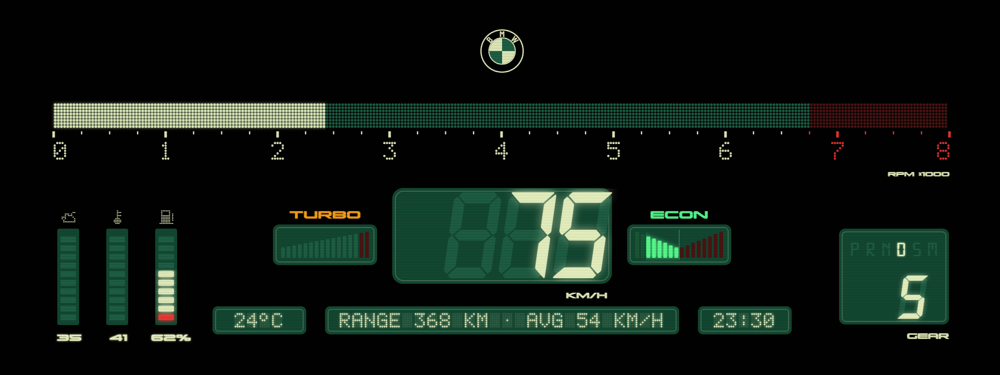

# Zeiger

Redraws the whole instrument cluster with a hand-drawn theme. Open **Zeiger** from the apps menu on the center screen: its page shows the themes, the warnings and the settings.

## Vintage Green and Vintage Cyan

An LCD from 1985, drawn in code by `cluster-design/vintage2/build.html` (`?v=green`, `?v=cyan`), one layout in two colourings: Green cream readouts on dark green windows, Cyan cyan fluorescent readouts on dark teal windows. Slanted digits over ghost 8s, P R N D S M and the gear, oil / water / fuel bars under pixel icons, scanlines, and a 2.5 s self-test at power-on.

- **Rpm:** a dot-matrix band (286 dot columns, ghost dots unlit, orange from 5200, red from about 6750) over a tick scale with dot-matrix numbers.
- **TURBO** (left of the speed): a lamp over a boost bar of 16 rising segments, 0.1 bar each.
- **ECON** (right of the speed): two halves of 8 segments growing from the middle outward.
  - Green: `econEco`, the engine load under 35 % of its peak torque; coasting fills it.
  - Red: `econLoad`, the load over it; full torque fills it.
- **Bottom:** three dot-matrix strips: the outside temperature, the range and average speed, the clock.
- **Roundel:** drawn in code in the theme's colours (BMW's white quadrants lit, its blue ones the windows' ghost colour).
- **Size:** 6.7 MiB in 23 layers on 3 connections, each.
- **Layers:** each face piece holds only its own pixels (a piece's box may take in the end of another, which was then drawn twice).

## VFD

A fluorescent display in the manner of the late-80s Japanese digital dashes, drawn in code by `cluster-design/vfd/build.html` (the design picture: `design.html`). Pale mint phosphor with a soft bloom on black.

- **Top:** the fuel band (dot columns, E to F, the pump orange under 15 %), the speed in slanted segment digits with SPEED and km/h, and the coolant line (C to H) with a 4x4 dot block riding on it, one of 17 places 5 °C apart.
- **Middle:** the rpm band (207 dot columns, red from 7000) over a straight scale 0-8 with a red dashed end, and the drive mode in a green lamp on the left. Right of the scale is black, where BMW draws its gear box.
- **Bottom:** three teal filter windows: SHIFT POSITION with the selector's letter and the gear number; the clock with OIL and OUT in dot matrix; RANGE.
- **Self-test:** 2.5 s with everything lit at power-on. No roundel: the dashes it follows had none.
- **Engine:** the coolant block and the orange pump are `segments` with `"one": true` (only the last segment reached is lit). The bloom is drawn into the fonts and pictures, so the colour theme's glow stays 0. The face is cut into 8 regions, each a z group of its own: 20 layers on 3 connections and 4.5 MiB of cluster-render's 16 MiB (with the start animation's hidden SYSTEM CHECK text).

## Apex and Apex Sport

A racing cluster, drawn in code by `cluster-design/apex/build.html` (`?v=sport` for Apex Sport) from the same drawing as its design pictures (`draw.js`).

- **Rpm:** a band of 32 blocks (up to 1500, level to 6500, down to 8000) that fills in one continuous line through the blocks: 4 px strips of a `segments` widget, lit white (Sport: yellow), orange from 6000, red from 6500.
- **Middle:** the speed, the gear (`{{gearnum}}`) and P R N D M. The letter in use is bigger and white (`{{is:stage:X}}`); the others are dim (`{{isnt:stage:X}}`), and the fourth place shows D, or S in the sport programme.
- **Bars:** boost (0-1.6 bar) and braking (`brakeG`, 0-1.2 g), one segment at a time.
- **Bottom row:** coolant (40-130 °C) and fuel in 2 px strips, and the clock (`{{time}}`, white, Michroma 38 px) between them, where the design had a logo.
- **Apex Sport:** a red glow over a red tray line, the band thicker.
- **Shift flash (Apex Sport):** a `bandflash` effect layer (shaders.js) draws the whole band in one colour and flashes it 5 times a second. It is white from 500 rpm before the shift point, yellow from 250 before, and red at it. Only a colour and an on / off go to the car, never pixels. The setting **Shift flash** turns it off.

The glows are one quarter-size picture stretched by the GPU. The rest of the face is 6-7 pieces. Every sheet is chosen by its z group, so the theme takes about 8-9 MiB of pixel memory and 15-16 layers on two connections.

## Dark Moon

A sunrise seen from orbit, drawn in code by `cluster-design/darkmoon/build.html`: the speed in a dark moon's disc under the sun, the selector and drive mode on the right, today's weather on the left (Open-Meteo, through the Store's Internet uplink), range and coolant at the bottom with a small clock between them (`{{time}}` in the second line's grey), everything mirrored about the middle.

## Underpass and Mist

Dark Moon's readouts and weather over a photo (`cluster-design/underpass` and `cluster-design/mist`, built by `cluster-design/photo/photo_theme.js`): soft scrims behind the readouts so they read on it, and black wherever BMW's gear box lands.

## Map Mist

The phone's map (waze-on-cluster) in a window in the middle of Mist's photo (`cluster-design/map_mist`): the speed on the left, the selector and drive mode on the right, range and coolant at the bottom with a small grey clock under the map between them.

## Removed themes

A car set to a removed theme shows the nearest one left (shared/hud.js `RENAMED`): Sunrise shows Mist, Map and Map Underpass show Map Mist, Vintage Amber shows Vintage Green. The engine features only they used stay in `shared/hud.js`: `"ownStrip"`, `"fixed"`, `"withMap"`.

## Home-screen widget

`widget.js`, through app.json `startWidget` and the kit's `ctx.widget` (kit/runtime/mgu.js). It uses BMW's Drive Recorder widget layout, as the kit's Live Data does (checked on a G05). The setting **Home-screen widget** picks what it shows:

- **Fit (0.26.0):** the part of the picture the HMI shows was measured on a G20 from photos: about 8 % of the width and 7.5 % of the height is cut off each side (`startWidget.safe`). Everything keeps 14 px more inside that, smaller than before, and the weather sits in the middle of the window's height (Sunrise's at the top, over its horizon).
- **Engine** (the default since 0.25.0): oil, coolant and boost, each as its value and a bar of 20 segments. The temperature bars are blue while cold (oil under 80 °C, coolant under 70 °C), green when warm and red over the Warnings limits, which show as a red tick; boost is orange, its peak of the last 5 s held as a white segment. On top: READY, or COLD and the shift point the cold-engine guard asks for. Boost comes from the sport display or, while the widget is placed, the engine unit (shared/hud.js `widgetBoost`).
- **Weather, Mist** (the default) and **Weather, Sunrise:** the weather on Mist's photo, or on a sunrise over mountains (an earlier Sunrise theme's). On the left: the place, the temperature now with its icon, the weather now in a word, and today's high, low and chance of rain (in blue). On the right: the next three days, each with its icon, high (white) and low (grey). It uses the cluster themes' own fonts and colours. Every line on the left shares a baseline with the right, and nothing goes below Sunrise's horizon. While the forecast shown is an old one and there's no internet, OFFLINE shows in amber beside the place. Backgrounds: `cluster-design/mist/widget_bg.html` and `cluster-design/sunrise/widget_bg.html`.
- **The cluster's theme:** ZEIGER, the shown theme's gallery picture (hud/previews, shrunk by averaging), its name, and the drive mode while "Change with SPORT / COMFORT / ECO PRO" is on.
- **Weather fetching:** the forecast (`shared/weather.js`, Open-Meteo, 4 days) is fetched while a widget is placed and shows the weather. This is apart from the themes' weather and the **Today's weather** setting. Like the themes, it needs the Store's Internet uplink.
- **Small widget:** the layout's text lines only (ASCII: the place, the weather now, today's high / low / rain, the next days).
- **Refresh:** redrawn when what it shows changes, else the same picture again every 30 s, in case the HMI dropped it.

## Fail-safe

Every layer of the theme plays a cluster-render animation: it holds its scale for 1.2 s and then shrinks to nothing. The engine (shared/hud.js `_failsafe`) starts it over every 200 ms, with the same animation number, so the service replaces it. If Zeiger hangs, the renewals stop and cluster-render takes the theme away on its own clock, so BMW's own cluster shows.

While the car moves, if the speed signal is over a second old, the theme hides at once and comes back half a second after the speed returns. Only the speed is checked, because a hybrid's rpm stays at 0, unchanged, while it drives on electricity. The log notes the longest gap between renewals once a minute when it is over 400 ms.

The bench shows both (bench/README.md): the hang button (`POST /hang`) and `stall: ["speed"]` in manual signals.

## Start animation

`shared/hud.js` plays a theme's start animation ("intro") once per run of the app: when the car starts, or when the theme is first picked. The animations are written to `hud/intros/<layout>.json` by `cluster-design/intro/make_intros.js`, which also describes each theme's scenario.

- **Not while moving:** it doesn't play while the car moves faster than 3 km/h, and it ends at once when the car moves off. The bench's demo drive plays it anyway.
- **Timing:** it holds its first frame until cluster-render says every layer of the theme is shown on the display (its `layer` events), then starts 0.3 s later (the photo themes too, since 0.25.1): big pictures take seconds through the renderer's upload budget, and at power-on BMW holds the display a while first. If some layers aren't shown 15 s after the layout was made, it plays anyway; if none are, it's dropped. The log says how long it waited (`start animation: ...`).
- **Values:** keyframes for rpm, speed, fuel, oil, coolant, boost, braking or ECON, straight between keys. `live` is the car's own value; `shift` and `shift-250` are relative to the shift point.
- **Texts:** a text per step, for typed-out lines and counters. `test` shows the widget's self-test string.
- **Self-test:** for a stretch it can be on too (`"test"` ms).
- **Layers:** a layer's opacity can follow a curve (`fade`), and the renderer can slide a layer into place (`move`).
- **Dark Moon, Mist, Underpass:** since 0.25.1 only a soft fade up out of black: the picture over 1.4 s, eased in and out, the readouts 0.3 s after it. The picture no longer slides in (on the car the slide looked like shaking).
- **Black underlay:** the photo themes get a black underlay (an effect layer, no pixel memory), so a fading picture never shows BMW's own cluster through it. An intro's `"underlay"` can be a rect, for a theme that leaves BMW's own strip showing.
- **Warnings:** no warning flashes during the animation, as its values are made up.
- **Cluster-render features:** the opacity and moves use cluster-render layer opacity and animations. Seen on the bench, not yet on a car. Where the car ignores them, the values and texts still play.
- **The setting:** **Start animation** turns it off, and with it the 2.5 s self-test of themes without an animation.

## The page

`page.js`, Zeiger's own page on the centre screen (since 0.24.0, written new; the design is `cluster-design/app_ui/mock.html` next to this repo). Two tabs in the header (since 0.26.0 without the kit's **All settings** list: everything is on the page):

- **Themes:** a gallery. The theme looked at is big in the middle, with its neighbours beside it and a dot per theme under it. A tap on the left or right half of the screen, a finger swiped sideways (the kit's `ctx.onSwipe`, a Zeiger addition) or the iDrive controller go through them; the arrows at the screen's edges only show the way. **BMW's own cluster** is not a card but a switch in the bottom right corner: on, BMW's own cluster shows (for the drive mode being set, while the theme changes with it); off, the theme from before comes back. Looking changes nothing on the cluster: **Use this theme** (or **Use for COMFORT / SPORT / ECO PRO**) does. Under it, **Change with the drive mode**, and with it on, the theme of each drive mode: tap one to give it another theme. The car's drive mode now is marked NOW.
- **Settings:** groups on the left, each with what it is set to now; the open group's rows on the right, a switch or `- value +`. The groups:
  - **Cluster:** start animation, today's weather, the phone's map in Map Mist, theme position (px to the right, -12 by default), night colours.
  - **BMW's cluster:** hide BMW's black boxes (test), leave BMW's bottom strip clear.
  - **Warnings:** oil and coolant temperature and boost; over its limit, the value flashes red on the cluster.
  - **Shift point:** redline, shift point before it, shift flash, cold-engine rev guard.

## Cold engine: the red zone moves (0.27.0)

With **Cold-engine rev guard** on (the default), the rev bars of Vintage Green, Vintage Cyan, VFD, Apex and Apex Sport start their red zone lower while the oil is cold: at 3500 rpm with the oil at 30 °C or under, then straight up with the oil temperature (100 rpm steps) back to the redline at 80 °C. In the zone the bar's segments are drawn red: dim while the rpm is under them, bright red once it reaches them; the bar's own red end keeps its colour. The shift point follows: "Shift point before redline" under the zone's start (3200 rpm cold with the default 300), so the Engine widget's COLD · SHIFT BY and Apex Sport's flash say the same.

- **How:** a segments widget with `"zone": true` (the layouts' rpm bars; the builders in `cluster-design/vintage2`, `vfd` and `apex` set it). shared/hud.js `_updateZone` redraws the segments whose state changed, the picture's own pixels recoloured, so no theme needed new pictures. The zone's start is `ShiftScore.coldRed(oil)` (shared/shift_score.js).
- **Not during** the start animation or the self-test (their values are made up).
  - **Units and time:** units (metric: km/h and °C are part of the drawing), clock, time zone, fuel tank size.
  - **Home-screen widget:** Weather, Mist (default), Weather, Sunrise, or The cluster's theme.
  - **About:** demo data, the version and the credits.
- **Pictures:** the gallery's big card uses `hero` (1152x432) from `hud/previews/<layout>.json`, made from the bench captures in `docs/images` by `cluster-design/app_ui/make_hero.js`; the rest `big` and `small`. One big picture is kept in memory at a time.
- **Fonts:** Barlow Semi Condensed (SemiBold `zsb`, Medium `zsm`) and Michroma (`zmi`) in the kit's atlas format (`kit/runtime/fonts/`), baked by `cluster-design/app_ui/bake_fonts.html`.
- **Steppers:** a list of choices (the widget, units, clock, ...) goes round: past the last, the first again. Numbers (redline, limits, position) stop at their ends.
- **Calibration** (BMW's cluster group): Off, Grid or Map frame on the cluster, to measure what BMW hides on your car's cluster; Off puts the themes from before back.

## Black boxes

- **In the middle, with the engine running, on a car that is not a real M:** the cluster is coded to BMW's M layout (often done with BimmerCode on cars with the M Sport or M Performance package). Code it back to the car's own layout (M Sport or M Performance) and restart the head unit; the boxes go away (checked on a G20, November 2026).
- **Just left of the gear letter:** BMW draws it behind its gear display on every car, over any theme. It can't be seen on any of Zeiger's themes (black background there).
- **A small one at the right edge** (about x 1840-1900, y 230-270): seen on a G20 over the Sunrise theme's sky. Zeiger's themes are black or nearly black there.
- **BMW's own bottom strip showing** under a theme doesn't take them away on a G20.

## Boost

Boost (Apex's and Apex Sport's bar and readout, Vintage Green's and Cyan's TURBO bar) comes from two places:

- **The sport display's signal** (FES `displayBoostPressure`): used while it comes several times a second (two values under 600 ms apart, the last one under 600 ms old).
- **The engine unit** (read-only UDS 0x22, `config.dme.boost`): asked up to 4 times a second whenever the sport display's value doesn't come that often, and then its value wins.

The log says which source is used (`boost from ...`).

## How a theme is made

1. Draw the cluster at 1920x720 (Illustrator, export SVG).
2. A build page turns the drawing into a face picture, segment bars and fonts (`cluster-design/<theme>/build.html` next to this repo).
3. The layout (`hud/layouts/<name>.json`) places the live parts. Widget types are documented in `shared/hud.js`.

Building, the bench and the engine: [docs/DEVELOPING.md](../../docs/DEVELOPING.md).
