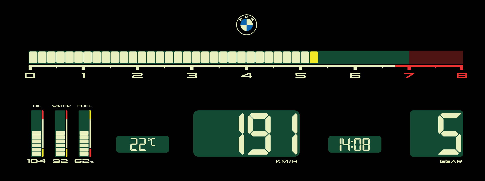

# Zeiger

Redraws the whole instrument cluster with a hand-drawn theme. Open **Zeiger** from the apps menu on the center screen: its page shows the themes, the warnings and the settings.

## Vintage

An 80s LCD dash in cream on dark green, drawn as `CAJGER-vintage.svg`.

- **Rpm bar:** 48 segments, 0 to 8000 rpm; yellow from 5200, red past 7000.
- **Oil, water, fuel:** 10 segments each; oil 40-150 °C, water 40-130 °C, fuel 0-100 %. The values sit under the bars.
- **Speed** (3 digits, leading zeros, km/h), **gear**, **clock**, **outside temperature** (°C).

## Settings

- **Change with SPORT / COMFORT / ECO PRO:** a theme per drive mode, or one theme always.
- **Units:** metric (km/h and °C are part of the drawing). **Clock:** 12 or 24 hours. **Time zone.** **Tank size.**
- **Warnings:** oil and water values flash red over their limits.
- **Calibration grid** and **Map calibration** help measure what BMW hides on your car's cluster.

## How a theme is made

1. Draw the cluster at 1920x720 (Illustrator, export SVG).
2. A build page turns the drawing into a face picture, segment bars and fonts (`cluster-design/vintage/build.html` next to this repo).
3. The layout (`hud/layouts/<name>.json`) places the live parts. Widget types are documented in `shared/hud.js`.
